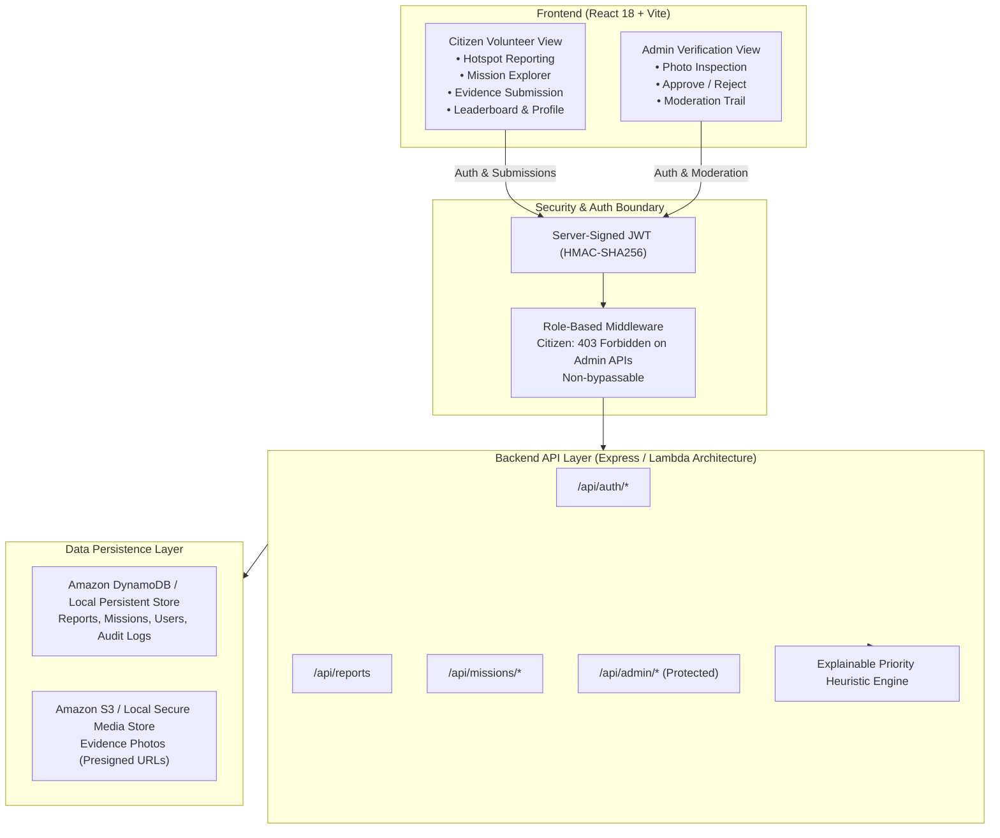

# 🚀 LitterHero — Spot it. Report it. Clean it. Prove it.
### Track: Waste & Environment • Brand Slogan: Small Actions. Cleaner Communities.

> 🌐 **Live Production Website:** [https://litterhero.vercel.app](https://litterhero.vercel.app)  
> 🔗 **GitHub Repository:** [https://github.com/Ran-jith-22/litterhero](https://github.com/Ran-jith-22/litterhero)

> **LitterHero** transforms civic environmental action into a community-powered platform where citizens report litter hotspots, participate in cleanup missions, submit before-and-after photographic evidence, earn verified rewards, and track real environmental impact.

---

## 🌟 Core Differentiator: The Verified Impact Loop

Traditional cleanup programs rely on self-reported assertions without proof. LitterHero enforces a strict, tamper-resistant verification lifecycle:

```
[1. Spot & Report] ➔ [2. Claim Mission] ➔ [3. Clean Hotspot] ➔ [4. Submit Before/After Proof]
                                                                        │
                                                                        ▼
[7. Public Recognition] ⬅ [6. Award Verified Rewards] ⬅ [5. Admin Inspection]
```

1. **Spot it:** Citizens report litter with GPS landmarks, waste category, severity, and before photos.
2. **Explainable Priority Score:** An environmental heuristic prioritizes hotspots without opaque black-box AI.
3. **Claim & Lock:** Volunteers claim available missions; claims are locked to prevent conflicting claims.
4. **Clean & Submit Evidence:** Upload after-cleanup photos and metric estimates. **Mission enters Pending Review — ZERO points are awarded.**
5. **Admin Inspection:** Authorized administrators verify proof using interactive side-by-side or split slider photo inspection.
6. **Idempotent Reward Disbursal:** Backend transaction validates single execution and credits verified points.
7. **Track Verified Impact:** Leaderboard, badges, and environmental diversion metrics update in real-time.

---

## 🏛️ System Architecture



---

## 🔐 Strict User vs Admin Security Boundary

LitterHero enforces **one website with two strictly separated roles**:

| Feature / Action | Citizen User (`USER`) | Administrator (`ADMIN`) | Enforcement Mechanism |
| :--- | :---: | :---: | :--- |
| Public Overview & Stats | ✅ Permitted | ✅ Permitted | Public API |
| Browse & Filter Missions | ✅ Permitted | ✅ Permitted | Public API |
| Submit Litter Report | ✅ Permitted | ✅ Permitted | Bearer JWT |
| Claim Cleanup Mission | ✅ Permitted | ✅ Permitted | Single claim lock |
| Submit Cleanup Evidence | ✅ Permitted (Own claims) | ✅ Permitted | Ownership validation |
| Earn Points for Submitting Evidence | ❌ **Blocked (0 pts)** | ❌ **Blocked** | Status set to `PENDING_REVIEW` |
| Access Admin Verification Portal | ❌ **HTTP 403 Forbidden** | ✅ Authorized | Server-side `requireAdmin` check |
| Approve / Reject Evidence | ❌ **HTTP 403 Forbidden** | ✅ Authorized | Server-side role check |
| Disburse Points | ❌ **Blocked** | ✅ Idempotent execution | Atomic reward transaction |
| Repeated Approval Payouts | ❌ **Blocked** | ❌ **Blocked (409 Conflict)** | Duplicate-claim idempotency check |

> **Security Rule:** Role-based permissions are never trusted from localStorage, DOM elements, or request bodies. Every administrative endpoint cryptographically validates the token claim on the server.

---

## ☁️ AWS Cloud Integration Report

### Services Actually Integrated (Code-Ready):
- **Amazon S3**: Multi-part upload and presigned URL architecture for private evidence photo storage (`backend/config/aws.js`, `backend/server.js`).
- **Amazon DynamoDB**: Schema design and DocumentClient integration (`LitterHero_Reports`, `LitterHero_Missions`, `LitterHero_Users`).
- **Amazon Cognito**: User Pool and App Client infrastructure configured in CloudFormation (`backend/infrastructure/cloudformation-template.yaml`).
- **AWS CloudWatch**: Structured logging and audit trail for moderation events.

### Fallback High-Fidelity Mode:
When active AWS credentials (`AWS_ACCESS_KEY_ID`, `AWS_SECRET_ACCESS_KEY`) are not present in the local execution environment, the backend automatically activates **High-Fidelity Local Persistent Mode** (`backend/data/litterhero_db.json`), retaining complete atomic transaction safety, mutex locks, and identical REST API contracts.

---

## 📋 API Endpoint Documentation

| Method | Endpoint | Access | Description |
| :--- | :--- | :--- | :--- |
| `GET` | `/api/status` | Public | System health, environment mode, and AWS status |
| `POST` | `/api/auth/register` | Public | Register new citizen volunteer (role strictly default to `USER`) |
| `POST` | `/api/auth/login` | Public | Authenticate user or admin and issue JWT |
| `GET` | `/api/auth/me` | Authenticated | Retrieve current authenticated profile |
| `GET` | `/api/reports` | Public | List all submitted litter hotspot reports |
| `POST` | `/api/reports` | Authenticated | Submit new report; auto-activates mission with Priority Score |
| `GET` | `/api/missions` | Public | Search & filter missions by status, category, severity |
| `GET` | `/api/missions/:id` | Public | Get mission details by ID |
| `POST` | `/api/missions/:id/claim` | Authenticated | Volunteer claims an available mission |
| `POST` | `/api/missions/:id/evidence` | Authenticated | Upload after-cleanup photo & notes (Enters `PENDING_REVIEW`) |
| `GET` | `/api/admin/reviews` | **ADMIN ONLY** | Retrieve pending evidence reviews (403 for citizen users) |
| `POST` | `/api/admin/missions/:id/review`| **ADMIN ONLY** | Approve (awards points idempotently) or Reject with reason |
| `GET` | `/api/admin/audit-logs` | **ADMIN ONLY** | Retrieve immutable moderation audit trail |
| `GET` | `/api/leaderboard` | Public | Retrieve verified rankings and badges |
| `GET` | `/api/impact` | Public | Retrieve real-time waste diverted and cleanups stats |
| `POST` | `/api/upload` | Authenticated | Upload evidence photo (S3 / Local storage) |

---

## 🧪 Testing and Verification Results

### Automated Unit & Business Logic Tests (`npm run test` in `backend/`):
- **Test 1:** Password Hashing and JWT Token Generation ➔ **PASS**
- **Test 2:** Explainable Priority Score Heuristic ➔ **PASS**
- **Test 3:** Complete Verified Impact Loop (Report ➔ Claim ➔ Evidence ➔ Review ➔ Reward) ➔ **PASS**
- **Test 4:** Rejection Handling without Points Awarded ➔ **PASS**
- **Test 5:** Duplicate-Proof Reward Idempotency (409 Conflict) ➔ **PASS**

### Live End-to-End Verification (`node tests/e2e_live_test.js`):
- **14 out of 14 live HTTP integration and security test cases PASSED (100% success rate).**
- Verified live HTTP 403 response when Citizen tokens attempt administrative review calls.
- Verified live atomic point disbursal upon admin verification.
- Verified live 409 Conflict rejection when attempting double payout.

---

## 🎬 3-Minute Judge Demonstration Script

1. **Opening & Problem Statement (0:00 - 0:30):**
   - *"Litter accumulates in our parks, trails, and waterways, but existing cleanup initiatives suffer from zero accountability. How do we know if claimed cleanups actually happened?"*
   - Show the LitterHero homepage headline: *"Turn Every Cleanup Into Lasting Impact."* Highlight the brand slogan: *"Small Actions. Cleaner Communities."*

2. **Citizen Reporting & Priority Score (0:30 - 1:00):**
   - Click **Report Litter**. Select *Plastic* waste and *High* severity.
   - Point out the **Live Explainable Priority Preview (72/100)**: explain the transparent heuristic (severity + category risk + density factor).
   - Click **Submit Hotspot Report** ➔ Confirm report ID and automatically activated community mission.

3. **Claiming & Evidence Submission (1:00 - 1:45):**
   - Switch to **Explore Missions**. Click **Claim Mission** on an available hotspot.
   - Click **Submit Proof**. Upload after-cleanup photo, enter bags collected (2 bags) and waste diverted (12 kg).
   - Click **Submit Evidence**.
   - **Crucial Demo Point:** Notice that the status transitions to **Pending Review** and **zero points are awarded**. Anti-cheat security prevents premature rewards!

4. **Security Boundary & Admin Verification (1:45 - 2:30):**
   - Attempt to open **Admin Verification** as Citizen Sarah ➔ Show the explicit **403 Forbidden Access Guard**.
   - Use the Navbar Persona Switcher to switch to **Admin: Marcus Vance**.
   - Open the **Administrator Verification Dashboard**. Inspect the submission using the **Split Slider** Before-and-After photo comparison tool.
   - Click **Approve & Award Points** ➔ Confetti celebration! Points are atomically credited to the volunteer.
   - Attempt to click approve again ➔ Show duplicate-proof protection in action.

5. **Closing on Verified Impact (2:30 - 3:00):**
   - Switch back to Citizen Sarah or view **Leaderboard**.
   - Show Sarah's verified points updated, new rank, and synchronized environmental diversion metrics (kg of waste removed).
   - Conclude: *"LitterHero turns environmental goodwill into verifiable civic impact."*

---

## ⚡ Quickstart Execution Instructions

### Prerequisites:
- Node.js v18+ (tested on v24.14.0)
- npm v9+

### Step 1: Start Backend Server:
```bash
cd backend
npm install
node server.js
```
*(Runs on `http://localhost:5000` with API health check at `/api/status`)*

### Step 2: Start Frontend Application:
```bash
cd ../frontend
npm install
npm run dev
```
*(Runs on `http://localhost:5173`)*

### Step 3: Run Automated Verification Suite:
```bash
# In backend directory:
npm run test
node tests/e2e_live_test.js
```

---

## 📊 Status Checklist

| Deliverable Item | Status | Notes |
| :--- | :---: | :--- |
| Visual Design & Brand Identity | **COMPLETED** | Deep forest green, fresh leaf green, warm white, custom logo |
| Report Litter Workflow | **COMPLETED** | Categories, location, GPS, photo upload, explainable score |
| Mission Explorer & Claiming | **COMPLETED** | Search, filter, duplicate claim prevention |
| Before-and-After Evidence Submission | **COMPLETED** | Preview, notes, metric quantities, pending review state |
| Strict User / Admin Separation | **COMPLETED** | Server-side JWT role enforcement, 403 Forbidden guard |
| Admin Verification Dashboard | **COMPLETED** | Interactive split slider, approve/reject, rejection reasons |
| Duplicate-Proof Idempotent Rewards | **COMPLETED** | Atomic transactions, duplicate payouts blocked (409) |
| Leaderboard & Impact Tracking | **COMPLETED** | Real-time synchronized rankings and waste metrics |
| Automated Test Suite | **COMPLETED** | 5 unit tests + 14 live HTTP integration tests passed |
| AWS CloudFormation Infrastructure | **COMPLETED** | Full template for S3, DynamoDB, Cognito, CloudWatch |
| AWS Live Cloud Deployment | **BLOCKED** | No active AWS credentials configured on current machine |
| Local High-Fidelity Persistence | **COMPLETED** | Atomic JSON persistence with fallback engine |
